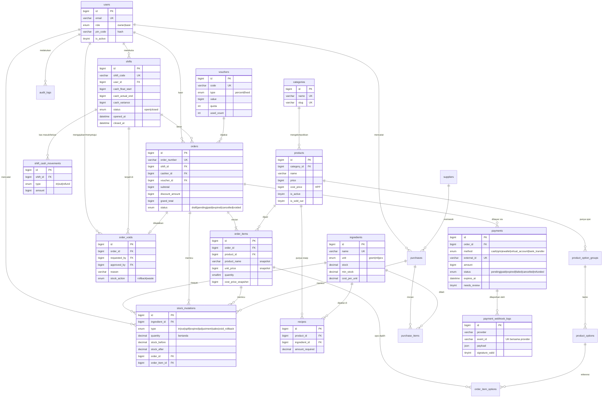

# Dokumentasi Database SIMKOTOL (MySQL 8)

Dokumen pendamping `PRD_SIMKOTOL_v2.md`. DDL lengkap ada di `database_simkotol.sql`.

**Konvensi**
- Engine InnoDB, charset `utf8mb4`, collation `utf8mb4_unicode_ci`.
- Uang = `BIGINT` dalam Rupiah (tanpa desimal, menghindari galat floating point).
- Stok & takaran = `DECIMAL(14,3)`; harga bahan per satuan = `DECIMAL(14,4)`.
- Tabel master memakai *soft delete* (`deleted_at`) agar histori transaksi tetap utuh.
- Tabel bawaan Laravel (`sessions`, `cache`, `jobs`, `failed_jobs`, `password_reset_tokens`, `notifications`) dibuat oleh `php artisan migrate` dan tidak ditampilkan di ERD.

---

## 1. ERD (Entity Relationship Diagram)



---

## 2. Daftar Tabel & Fungsi (27 tabel + 3 view)

| # | Tabel | Fungsi | Fase |
| :-: | :--- | :--- | :-: |
| 1 | `users` | Akun owner/kasir, hash PIN approval, penguncian PIN | 1 |
| 2 | `settings` | Pengaturan toko, pajak, struk, pembayaran (key-value) | 1 |
| 3 | `number_sequences` | Penomoran harian (pesanan, antrean, pembelian, shift) | 1 |
| 4 | `shifts` | Shift kasir + ringkasan kas | 1 |
| 5 | `shift_cash_movements` | Kas masuk/keluar/refund tunai dalam shift | 1 |
| 6 | `categories` | Kategori menu | 1 |
| 7 | `products` | Menu, harga jual, HPP, status | 1 |
| 8 | `product_option_groups` | Grup opsi (ukuran, gula) | 2 |
| 9 | `product_options` | Pilihan opsi + selisih harga | 2 |
| 10 | `ingredients` | Bahan baku, stok, minimum, harga rata-rata | 1 |
| 11 | `suppliers` | Pemasok | 1 |
| 12 | `purchases` | Header pembelian bahan (stok masuk) | 1 |
| 13 | `purchase_items` | Rincian pembelian | 1 |
| 14 | `recipes` | Resep / BOM | 1 |
| 15 | `vouchers` | Kode diskon | 1 |
| 16 | `banners` | Banner promo | 1 |
| 17 | `orders` | Header pesanan (status, total, pajak, diskon) | 1 |
| 18 | `order_items` | Rincian pesanan + snapshot harga & HPP | 1 |
| 19 | `order_item_options` | Snapshot opsi yang dipilih | 2 |
| 20 | `payments` | Percobaan pembayaran per pesanan (QR, VA, tunai) | 1 |
| 21 | `payment_webhook_logs` | Log webhook + idempotensi | 1 |
| 22 | `order_voids` | Catatan void, approver, alasan, refund | 1 |
| 23 | `stock_mutations` | Buku besar stok (semua perubahan stok) | 1 |
| 24 | `audit_logs` | Jejak audit aksi sensitif | 1 |
| — | `v_ingredient_stock_status` | View: status stok ok/low/out | 1 |
| — | `v_product_availability` | View: sisa porsi maksimal per menu | 1 |
| — | `v_daily_sales` | View: penjualan harian (paid) | 1 |

> Tabel Fase 2 (`product_option_groups`, `product_options`, `order_item_options`) sudah dibuat agar migrasi nanti tidak mengubah struktur transaksi. Boleh dilewati di migrasi awal.

---

## 3. Ringkasan Relasi (Foreign Key)

| Dari (child) | Ke (parent) | Kardinalitas | On Delete | Catatan |
| :--- | :--- | :-: | :-: | :--- |
| `shifts.user_id` | `users.id` | N:1 | RESTRICT | |
| `shifts.closed_by` | `users.id` | N:1 | SET NULL | tutup paksa oleh owner |
| `shift_cash_movements.shift_id` | `shifts.id` | N:1 | RESTRICT | |
| `products.category_id` | `categories.id` | N:1 | RESTRICT | |
| `recipes.product_id` | `products.id` | N:1 | CASCADE | unik (product, ingredient) |
| `recipes.ingredient_id` | `ingredients.id` | N:1 | RESTRICT | |
| `purchases.supplier_id` | `suppliers.id` | N:1 | SET NULL | |
| `purchase_items.purchase_id` | `purchases.id` | N:1 | CASCADE | |
| `purchase_items.ingredient_id` | `ingredients.id` | N:1 | RESTRICT | |
| `orders.shift_id` | `shifts.id` | N:1 | RESTRICT | |
| `orders.cashier_id` | `users.id` | N:1 | RESTRICT | |
| `orders.voucher_id` | `vouchers.id` | N:1 | SET NULL | kode juga di-snapshot |
| `order_items.order_id` | `orders.id` | N:1 | CASCADE | |
| `order_items.product_id` | `products.id` | N:1 | SET NULL | nama & harga di-snapshot |
| `payments.order_id` | `orders.id` | N:1 | RESTRICT | 1 order banyak payment |
| `payment_webhook_logs.payment_id` | `payments.id` | N:1 | SET NULL | |
| `order_voids.order_id` | `orders.id` | 1:1 | RESTRICT | unik per order |
| `order_voids.approved_by` | `users.id` | N:1 | RESTRICT | wajib owner |
| `stock_mutations.ingredient_id` | `ingredients.id` | N:1 | RESTRICT | |
| `stock_mutations.order_id / order_item_id / purchase_id` | `orders` / `order_items` / `purchases` | N:1 | SET NULL | sumber mutasi (untuk audit & rollback) |
| `audit_logs.user_id` | `users.id` | N:1 | SET NULL | |

---

## 4. Keputusan Desain Penting

1. **Snapshot di transaksi**: `order_items` menyimpan `product_name`, `unit_price`, dan `cost_price_snapshot`. Mengubah harga/resep/nama menu tidak mengubah laporan lama.
2. **Buku besar stok** (`stock_mutations`): setiap perubahan stok punya `stock_before` dan `stock_after`, plus sumber (`order_id`, `purchase_id`). Void *rollback* membaca mutasi `sales` asli sehingga perubahan resep tidak berpengaruh (BR-18).
3. **Satu shift open per kasir** dijamin database lewat kolom generated `open_lock` + unique index (nilai `NULL` untuk shift closed tidak dianggap duplikat).
4. **Satu order banyak payment**: QRIS yang expired bisa dibuat ulang atau diganti tunai tanpa menimpa riwayat.
5. **Idempotensi webhook**: unik `(provider, event_id)` di `payment_webhook_logs`; `payments.external_id` unik sebagai referensi ke gateway.
6. **Pembayaran terlambat**: `payments.needs_review` + `review_note` agar owner memutuskan manual (BR-24).
7. **Nomor antrean** unik per hari lewat `(queue_date, queue_number)`; nomor dibuat dari `number_sequences` dengan `SELECT ... FOR UPDATE`.
8. **Stok boleh negatif** (kolom `DECIMAL` bertanda) untuk kasus pembayaran non-tunai yang sudah diterima (BR-16); validasi tunai dilakukan di aplikasi.
9. **Enum selaras PRD**: status pesanan `draft/pending/paid/expired/cancelled/voided`, metode bayar 5 jenis.
10. **Tidak ada trigger**: logika stok & status dijalankan di Service Laravel dalam satu transaksi agar mudah diuji dan dilacak.

---

## 5. Pola Query & Transaksi Kritis

### 5.1 Konfirmasi PAID + pengurangan stok (dalam satu transaksi)
```sql
START TRANSACTION;

-- 1. Kunci order & pastikan masih boleh diproses
SELECT id, status FROM orders WHERE id = :order_id FOR UPDATE;
-- (aplikasi: lanjut hanya jika status = 'pending'; jika 'paid', hentikan = idempoten)

-- 2. Hitung kebutuhan bahan dari resep, kunci baris bahan (urut id untuk cegah deadlock)
SELECT i.id, i.stock, SUM(r.amount_required * oi.quantity) AS needed
FROM order_items oi
JOIN recipes r     ON r.product_id = oi.product_id
JOIN ingredients i ON i.id = r.ingredient_id
WHERE oi.order_id = :order_id
GROUP BY i.id, i.stock
ORDER BY i.id
FOR UPDATE;

-- 3. Per bahan per item: kurangi stok & catat mutasi (diulang oleh aplikasi)
UPDATE ingredients SET stock = stock - :qty WHERE id = :ingredient_id;
INSERT INTO stock_mutations
  (ingredient_id, type, quantity, stock_before, stock_after, order_id, order_item_id, user_id, created_at)
VALUES (:ingredient_id, 'sales', -:qty, :before, :after, :order_id, :order_item_id, :user_id, NOW());

-- 4. Ubah status, voucher, payment
UPDATE orders   SET status = 'paid', paid_at = NOW() WHERE id = :order_id;
UPDATE payments SET status = 'paid', paid_at = NOW() WHERE id = :payment_id;
UPDATE vouchers SET used_count = used_count + 1 WHERE id = :voucher_id;

COMMIT;
```

### 5.2 Void dengan rollback stok
```sql
-- Ambil mutasi penjualan asli, lalu kembalikan (hanya jika stock_action = 'rollback')
SELECT ingredient_id, order_item_id, -quantity AS qty_to_return
FROM stock_mutations
WHERE order_id = :order_id AND type = 'sales';
-- Per baris: UPDATE ingredients SET stock = stock + qty; INSERT stock_mutations type 'void_rollback'
-- Lalu: INSERT order_voids, UPDATE orders SET status='voided', voided_at=NOW(),
--       UPDATE vouchers SET used_count = used_count - 1 (jika ada voucher)
```

### 5.3 Expected cash saat tutup shift
```sql
SELECT
  s.cash_float_start
  + COALESCE((SELECT SUM(p.amount) FROM payments p JOIN orders o ON o.id = p.order_id
              WHERE o.shift_id = s.id AND o.status = 'paid'
                AND p.method = 'cash' AND p.status = 'paid'), 0)
  + COALESCE((SELECT SUM(amount) FROM shift_cash_movements WHERE shift_id = s.id AND type = 'in'), 0)
  - COALESCE((SELECT SUM(amount) FROM shift_cash_movements WHERE shift_id = s.id AND type IN ('out','refund')), 0)
  AS cash_expected_end
FROM shifts s WHERE s.id = :shift_id;
```

### 5.4 Laporan laba kotor per produk
```sql
SELECT oi.product_name,
       SUM(oi.quantity)                                   AS qty,
       SUM(oi.subtotal)                                   AS penjualan_kotor,
       SUM(oi.quantity * oi.cost_price_snapshot)          AS hpp,
       SUM(oi.subtotal) - SUM(oi.quantity * oi.cost_price_snapshot) AS laba_kotor
FROM order_items oi
JOIN orders o ON o.id = oi.order_id
WHERE o.status = 'paid' AND o.paid_at BETWEEN :from AND :to
GROUP BY oi.product_name
ORDER BY laba_kotor DESC;
```

### 5.5 Bahan kritis
```sql
SELECT * FROM v_ingredient_stock_status WHERE stock_status IN ('low','out') ORDER BY stock ASC;
```

---

## 6. Indeks Utama (untuk performa)

| Tabel | Indeks | Tujuan |
| :--- | :--- | :--- |
| `orders` | `(status, ordered_at)`, `(shift_id, status)`, `paid_at` | Dashboard, riwayat, tutup shift |
| `payments` | `(status, expires_at)`, `external_id` unik | Job penandaan expired, pencarian webhook |
| `stock_mutations` | `(ingredient_id, created_at)`, `(type, created_at)`, `order_id` | Laporan bahan, rollback |
| `products` | `(category_id, is_active)`, `name` | Katalog & pencarian POS |
| `vouchers` | `(is_active, starts_at, ends_at)`, `code` unik | Validasi voucher |
| `audit_logs` | `(user_id, created_at)`, `(auditable_type, auditable_id)` | Penelusuran audit |

---

## 7. Catatan Implementasi di Laravel

- **Seeder awal**: akun owner (password & PIN di-hash `Hash::make`), kategori contoh, dan data `settings` (sudah ada di akhir file SQL).
- **Migrasi**: file `.sql` dapat dipakai langsung (`mysql -u root -p < database_simkotol.sql`), atau diterjemahkan menjadi migration Laravel per tabel agar versi skema terkelola. Kolom `open_lock` memakai `->virtualAs()/storedAs()` di Schema Builder.
- **Job terjadwal** (`schedule`): tiap menit tandai `payments` dengan `status='pending' AND expires_at < NOW()` menjadi `expired` dan order terkait menjadi `expired`; tiap hari bersihkan pesanan `draft` dari shift yang sudah ditutup.
- **Backup**: `mysqldump --single-transaction` harian (lihat NFR-14 di PRD).
- **Zona waktu**: set `APP_TIMEZONE=Asia/Jakarta` dan `time_zone='+07:00'` pada koneksi database agar `NOW()` konsisten.
