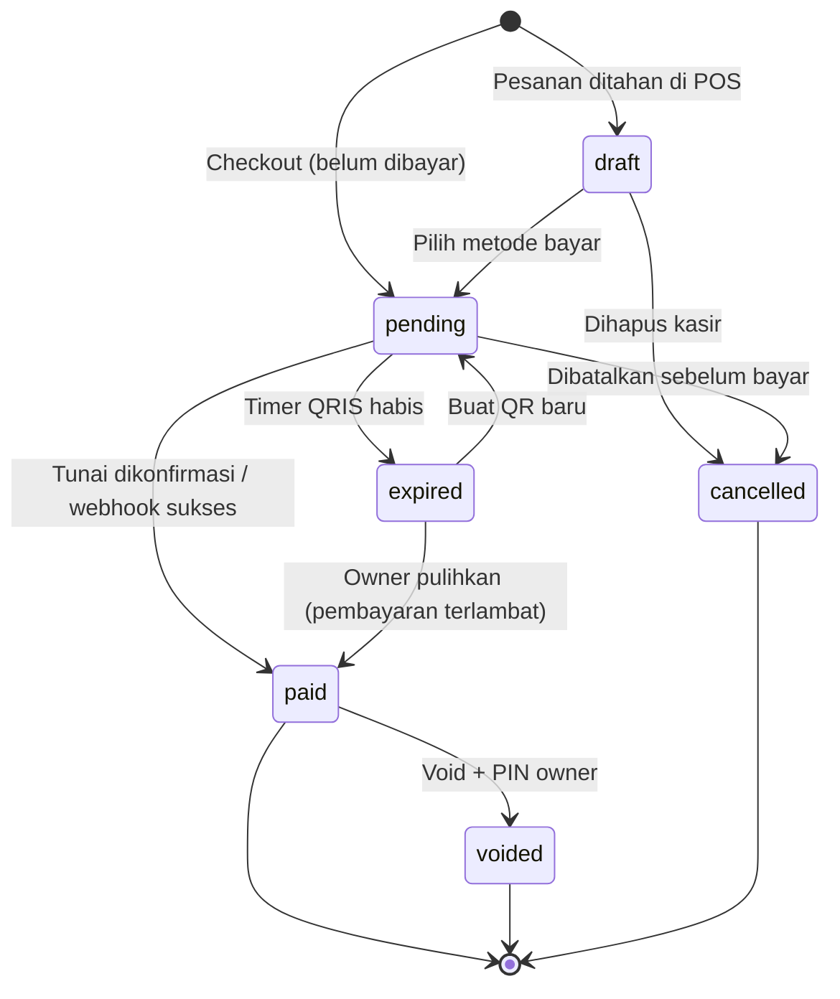
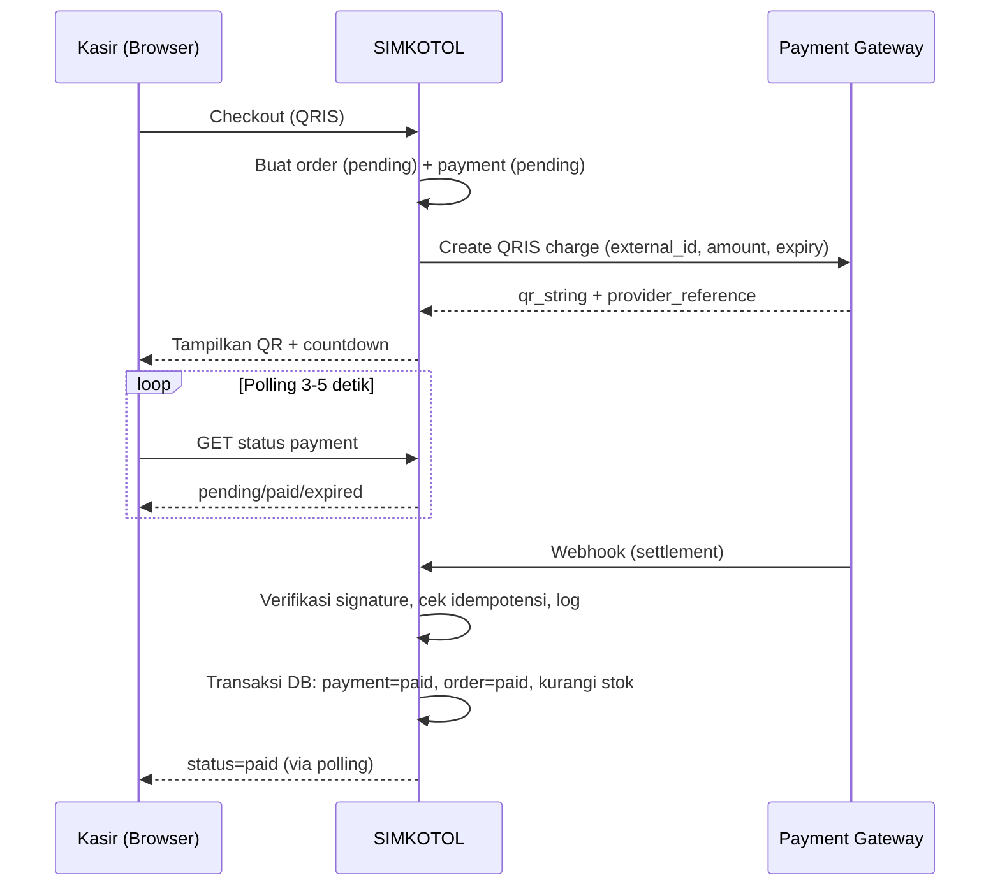

# PRD SIMKOTOL v2.0
## Sistem Manajemen Kopi Titik Nol

| Item | Keterangan |
| :--- | :--- |
| Versi dokumen | 2.0 (lengkap, menggantikan v1.0) |
| Status | Draft untuk review & persetujuan |
| Dokumen pendamping | `DATABASE_SIMKOTOL.md` (ERD & kamus data), `database_simkotol.sql` (DDL MySQL 8) |
| Bahasa & zona waktu | Bahasa Indonesia, WIB (`Asia/Jakarta`), mata uang Rupiah (IDR) |

> **Cara membaca dokumen ini**: setiap aturan bisnis diberi kode `BR-xx`, user story diberi kode `US-xx`, dan kebutuhan non-fungsional diberi kode `NFR-xx` agar mudah dirujuk di tiket, test case, dan code review. Hal yang belum diputuskan pemilik bisnis ditandai **[ASUMSI]** dan dikumpulkan di Bagian 16.

---

## 1. Ringkasan Produk

### 1.1 Latar belakang & masalah
Kedai kopi *Titik Nol* membutuhkan satu sistem untuk kasir (POS), pengelolaan stok bahan baku berbasis resep, dan pelaporan. Pencatatan manual menyebabkan:
- stok bahan tidak sinkron dengan penjualan (susu/kopi habis tanpa peringatan),
- selisih kas akhir shift sulit dilacak,
- laba tidak diketahui karena harga pokok (HPP) tidak dihitung,
- pembatalan transaksi tidak terkontrol.

### 1.2 Tujuan
1. Transaksi kasir cepat, dengan pembayaran tunai dan non-tunai (QRIS dinamis).
2. Stok bahan berkurang otomatis sesuai resep (BOM) dan dapat dilacak per transaksi.
3. Owner memantau omzet, laba kotor, dan stok kritis kapan saja.
4. Kas per shift akurat dan setiap void bisa diaudit.

### 1.3 Persona
| Persona | Deskripsi | Kebutuhan utama |
| :--- | :--- | :--- |
| **Owner** | Pemilik, jarang di kedai, memantau dari HP/laptop | Laporan, kontrol stok, approval void, kelola menu/staf |
| **Kasir** | Staf shift, bekerja cepat di tablet/PC kasir | Input pesanan cepat, bayar, cetak struk, tutup shift |

### 1.4 Metrik keberhasilan (target 3 bulan setelah rilis)
| Metrik | Target |
| :--- | :--- |
| Waktu rata-rata input pesanan 3 item sampai bayar tunai | ≤ 45 detik |
| Selisih stok sistem vs stok opname fisik | ≤ 3% per bahan |
| Transaksi QRIS berstatus benar (tidak ada "bayar tapi belum lunas") | ≥ 99,5% |
| Shift yang ditutup dengan data kas lengkap | 100% |
| Laporan penjualan harian dibuka owner tanpa bantuan developer | 100% |

---

## 2. Ruang Lingkup

### 2.1 MVP (Fase 1)
Autentikasi 2 role, manajemen menu & kategori, bahan baku & stok masuk/keluar, resep (BOM), POS (tunai + QRIS dinamis), shift (buka/tutup/selisih kas), void dengan approval PIN owner, struk (cetak browser + WhatsApp link), voucher & banner, dashboard, laporan penjualan / bahan / laba kotor dengan export PDF & Excel, notifikasi stok menipis, audit log.

### 2.2 Fase 2
E-Wallet / Virtual Account / Transfer via gateway, opsi/varian produk dengan penyesuaian resep (mis. ukuran besar = kopi +6 gram), stok opname terjadwal, biaya operasional (laba bersih), PWA/mode offline, cetak ESC/POS langsung (RawBT/QZ Tray), multi-cabang, laporan pajak.

### 2.3 Di luar lingkup (out of scope)
Manajemen karyawan/penggajian, program loyalitas/poin, aplikasi pemesanan pelanggan (self-order), integrasi GoFood/GrabFood/ShopeeFood, akuntansi penuh.

---

## 3. Glosarium
| Istilah | Arti |
| :--- | :--- |
| BOM / Resep | Daftar bahan dan takaran untuk membuat 1 porsi menu |
| HPP | Harga pokok penjualan = Σ (takaran × harga bahan per satuan) |
| Float / Modal awal kas | Uang tunai di laci kas saat shift dibuka |
| Cash Variance | Uang fisik − uang yang seharusnya ada menurut sistem |
| Void | Pembatalan transaksi yang sudah lunas |
| Rollback stok | Pengembalian stok bahan akibat void |
| Webhook | Callback HTTP dari payment gateway saat status bayar berubah |

---

## 4. Teknologi & Arsitektur

| Lapisan | Pilihan | Catatan |
| :--- | :--- | :--- |
| Framework | **Laravel 12** (PHP 8.3) atau versi stabil terbaru saat kickoff | Laravel 11 sudah melewati masa dukungan keamanan, verifikasi versi saat mulai |
| Frontend | Blade + Tailwind CSS + **Livewire 3** + Alpine.js | Interaksi keranjang dilakukan di sisi klien (Alpine), Livewire untuk checkout & data server |
| Database | **MySQL 8.0.16+** (InnoDB, utf8mb4) | Wajib InnoDB untuk transaksi & foreign key |
| Auth | Laravel Breeze (session) + middleware role | PIN approval terpisah dari password |
| Payment Gateway | **Midtrans** (Core API QRIS) **[ASUMSI]** | Dibungkus interface `PaymentGatewayInterface` agar bisa diganti Xendit/Pakasir |
| Queue | Database queue (Fase 1), Redis jika perlu | Untuk pemrosesan webhook, export besar, notifikasi |
| Export | `barryvdh/laravel-dompdf`, `maatwebsite/excel` | |
| Grafik | Chart.js | |
| Ikon | Lucide | |
| Hosting | VPS Linux (Nginx + PHP-FPM + MySQL), HTTPS wajib | Webhook gateway membutuhkan URL publik HTTPS |

**Prinsip arsitektur**
- Logika bisnis ditempatkan di *Service/Action class* (`CheckoutService`, `StockService`, `VoidService`, `ShiftService`, `PaymentService`), bukan di controller/Livewire component.
- Semua operasi yang mengubah stok/uang berjalan dalam **satu transaksi database**.
- Harga, nama produk, dan HPP di-**snapshot** ke `order_items` agar laporan lama tidak berubah saat menu diedit.

---

## 5. Role & Matriks Hak Akses

Legenda: ✅ penuh · 👁 hanya lihat · 🔸 terbatas (lihat catatan) · ❌ tidak ada akses

| Fitur / Aksi | Owner | Kasir |
| :--- | :---: | :---: |
| Login / logout | ✅ | ✅ |
| Dashboard owner | ✅ | ❌ |
| CRUD kategori & menu | ✅ | ❌ |
| Toggle "habis" manual pada menu | ✅ | ✅ |
| Lihat ketersediaan menu | ✅ | 👁 |
| CRUD bahan baku | ✅ | ❌ |
| Stok masuk / pembelian | ✅ | ❌ |
| Stok keluar (spill/expired/adjustment) | ✅ | ❌ |
| Lihat level stok bahan | ✅ | 🔸 hanya status (aman/menipis/habis), tanpa harga |
| CRUD resep | ✅ | ❌ |
| POS: buat pesanan & bayar | ✅ | ✅ |
| Buka / tutup shift | 🔸 (bila ikut menjadi kasir) | ✅ shift sendiri |
| Kas masuk/keluar di shift | ✅ | ✅ shift sendiri |
| Riwayat transaksi | ✅ semua | 🔸 hanya shift aktif miliknya |
| Ajukan void | ✅ | ✅ (butuh PIN owner) |
| Setujui void | ✅ | ❌ |
| Voucher & banner | ✅ | 👁 banner tampil |
| Laporan & export | ✅ | 🔸 hanya ringkasan shift sendiri |
| Kelola pengguna & reset PIN | ✅ | ❌ |
| Pengaturan toko & struk | ✅ | ❌ |
| Audit log | ✅ | ❌ |

---

## 6. Aturan Bisnis

### 6.1 Pesanan, harga & pajak
- **BR-01** Pesanan hanya dapat dibuat jika kasir memiliki **shift berstatus open**.
- **BR-02** Satu kasir hanya boleh punya **satu shift open** pada satu waktu (dijamin di level DB).
- **BR-03** Urutan perhitungan: `subtotal` → diskon voucher → `subtotal setelah diskon` → PPN/pajak → service charge → pembulatan → `grand_total`.
- **BR-04** Pajak (PB1/PPN) dan service charge **dikonfigurasi di pengaturan** (default 0%). Harga menu dianggap **belum termasuk pajak** **[ASUMSI]**; opsi *tax inclusive* disimpan di pengaturan.
- **BR-05** Pembulatan tunai ke kelipatan Rp100 terdekat (ke bawah) **[ASUMSI]**, selisih disimpan di `rounding_amount`.
- **BR-06** Nomor pesanan format `SKT-YYMMDD-0001` (reset harian). Nomor antrean `1..n` reset harian, dipakai untuk memanggil pelanggan.
- **BR-07** Tipe pesanan: `dine_in` atau `take_away`. Nama & nomor WhatsApp pelanggan **opsional**.

### 6.2 Voucher
- **BR-08** Satu pesanan maksimal **satu voucher** (tidak bisa digabung).
- **BR-09** Voucher valid jika: aktif, dalam rentang `starts_at`–`ends_at`, kuota tersisa, dan subtotal ≥ `min_purchase`.
- **BR-10** Tipe `percent` dihitung dari subtotal dan dibatasi `max_discount` jika diisi; tipe `fixed` tidak boleh melebihi subtotal.
- **BR-11** Kuota (`used_count`) bertambah saat pesanan **PAID**, dan berkurang kembali saat **VOIDED**.

### 6.3 Stok & resep
- **BR-12** Stok bahan dikurangi **hanya saat pesanan berstatus PAID**, dalam satu transaksi dengan perubahan status.
- **BR-13** Setiap pengurangan dicatat di `stock_mutations` (tipe `sales`) dengan referensi `order_id` & `order_item_id`, serta `stock_before`/`stock_after`.
- **BR-14** Ketersediaan menu = `min( floor(stok bahan ÷ takaran) )` atas semua bahan di resepnya. Menu tanpa resep dianggap selalu tersedia. Menu dengan ketersediaan 0 otomatis tampil **Habis** dan tidak bisa ditambahkan ke keranjang.
- **BR-15** Pengecekan stok saat menambah ke keranjang bersifat **peringatan awal**; pengecekan **final** dilakukan saat pembayaran dengan penguncian baris (`SELECT … FOR UPDATE`, urut `ingredient_id` untuk menghindari deadlock).
- **BR-16** Jika pembayaran non-tunai sudah diterima tetapi stok ternyata kurang (kasus berebut stok terakhir), transaksi **tetap PAID** (uang sudah masuk), stok boleh menjadi negatif, dan sistem membuat notifikasi + penanda untuk owner.
- **BR-17** Untuk pembayaran tunai, jika stok kurang saat konfirmasi, sistem **menolak** dan menampilkan bahan yang kurang.
- **BR-18** Perubahan resep **tidak mengubah transaksi lama**. Rollback void selalu membaca `stock_mutations` asli, bukan resep terbaru.
- **BR-19** Harga bahan per satuan (`cost_per_unit`) dihitung **rata-rata bergerak (moving average)** setiap stok masuk dari pembelian. HPP menu dihitung ulang saat harga bahan/resep berubah, dan di-snapshot per `order_items`.
- **BR-20** Notifikasi stok menipis muncul jika `stock ≤ min_stock`; status "habis" jika `stock ≤ 0`.

### 6.4 Pembayaran
- **BR-21** Tunai: kasir memasukkan uang diterima; kurang dari total ditolak; kembalian dihitung otomatis.
- **BR-22** QRIS dinamis: QR dibuat per pembayaran dengan masa berlaku **15 menit** (dapat diatur 15–30 menit). Status diperbarui lewat webhook, dengan **polling cadangan** tiap 3–5 detik dari layar kasir.
- **BR-23** Webhook harus: diverifikasi signature, **idempoten** (event yang sama tidak diproses dua kali), dan semua payload disimpan di `payment_webhook_logs`.
- **BR-24** Jika webhook "bayar sukses" tiba **setelah** pembayaran EXPIRED, pembayaran ditandai `needs_review`, pesanan **tidak otomatis PAID**. Owner memilih: *Pulihkan jadi PAID* atau *Refund manual* **[ASUMSI]**.
- **BR-25** Pembayaran QRIS yang EXPIRED/dibatalkan dapat dibuat ulang dengan payment baru untuk pesanan yang sama selama pesanan belum CANCELLED.

### 6.5 Shift & kas
- **BR-26** Buka shift mewajibkan input modal awal kas (≥ 0).
- **BR-27** **Expected Cash** = `modal awal + penjualan tunai (PAID) + kas masuk − kas keluar`. Pesanan yang di-void **tidak dihitung** sebagai penjualan; jika void dilakukan setelah uang tunai kembali ke pelanggan di shift berjalan, dicatat sebagai refund tunai.
- **BR-28** **Cash Variance** = `uang fisik − expected cash`. Variance ≠ 0 tetap boleh ditutup, tetapi wajib mengisi catatan.
- **BR-29** Shift tidak bisa ditutup jika masih ada pesanan **PENDING**/draft (harus diselesaikan atau dibatalkan dulu).
- **BR-30** Shift lupa ditutup: saat kasir login keesokan harinya, sistem memaksa menutup shift lama terlebih dahulu. Owner dapat menutup paksa dengan catatan.
- **BR-31** Setelah ditutup, shift **tidak dapat diubah**; koreksi hanya melalui catatan owner.

### 6.6 Void
- **BR-32** Void hanya untuk pesanan **PAID**, memerlukan **PIN owner** (6 digit) dan **alasan wajib** (minimal 5 karakter).
- **BR-33** Void dibatasi pada pesanan **hari yang sama** untuk kasir; void pesanan lebih lama hanya dapat dilakukan owner **[ASUMSI]**.
- **BR-34** Saat void, kasir/owner memilih perlakuan stok:
  - **Rollback**: minuman belum dibuat, stok dikembalikan penuh (mutasi `void_rollback`).
  - **Waste**: minuman sudah dibuat, stok **tidak** dikembalikan; kerugian tercatat di laporan.
- **BR-35** Void bersifat penuh (seluruh pesanan). Void parsial/retur item tidak ada di MVP.
- **BR-36** Refund: tunai dikembalikan dari laci kas (tercatat sebagai pengurang kas); non-tunai dikembalikan **manual** oleh owner lewat dashboard gateway/rekening, statusnya dicatat di `order_voids.refund_status`.
- **BR-37** Kegagalan PIN 5 kali berturut-turut mengunci fitur approval selama 15 menit.

### 6.7 Pengguna & keamanan
- **BR-38** Password minimal 8 karakter; PIN 6 digit angka disimpan sebagai **hash** (bukan teks biasa).
- **BR-39** Akun nonaktif tidak bisa login; akun yang sudah punya transaksi **tidak boleh dihapus permanen** (soft delete/nonaktif).
- **BR-40** Menu/bahan yang sudah dipakai transaksi tidak dihapus permanen, hanya dinonaktifkan/di-soft-delete.

---

## 7. Modul, User Story & Acceptance Criteria

### 7.1 Autentikasi & Pengguna
**US-01 Login** — *Sebagai pengguna, saya ingin login dengan email & password agar mengakses fitur sesuai role.*
- Given kredensial valid, When login, Then Owner diarahkan ke Dashboard dan Kasir ke halaman POS/Buka Shift.
- Given 5 kali gagal dalam 1 menit, Then login dikunci sementara (rate limit) dengan pesan jelas.
- Given akun nonaktif, Then login ditolak.

**US-02 Kelola pengguna** — *Sebagai owner, saya ingin menambah/mengubah/menonaktifkan kasir dan mereset password/PIN.*
- Email unik; role hanya `owner`/`kasir`; PIN hanya wajib untuk akun owner (untuk approval).
- Menonaktifkan kasir yang sedang punya shift open ditolak sampai shift ditutup.

### 7.2 Menu & Kategori
**US-03 Kelola kategori** — nama unik, slug otomatis, urutan tampil, ikon.
- Kategori yang masih punya menu aktif tidak bisa dihapus.

**US-04 Kelola menu** — *Sebagai owner, saya ingin mengelola menu beserta foto, harga, dan status.*
- Field: nama (wajib, maks 120), kategori (wajib), harga (wajib, ≥ 0, integer Rupiah), foto (opsional, JPG/PNG/WebP maks 2 MB, otomatis di-resize 600×600), deskripsi, status aktif, SKU opsional.
- Menu nonaktif tidak tampil di POS.
- Perubahan harga **tidak** memengaruhi transaksi lama (snapshot).
- Menampilkan HPP dan margin (%) di form berdasarkan resep.

**US-05 Tandai menu habis manual** — kasir/owner dapat menandai menu "Habis" (mis. bahan tidak tercatat). Perubahan tercatat di audit log.

### 7.3 Bahan Baku, Stok & Resep
**US-06 Kelola bahan baku** — field: nama, SKU, satuan (`gram`/`ml`/`pcs`), stok awal, stok minimum, harga per satuan awal.
- Satuan tidak bisa diubah setelah ada resep/mutasi.

**US-07 Stok masuk (pembelian)** — *Sebagai owner, saya mencatat pembelian bahan dengan supplier, jumlah, dan harga.*
- Menambah `stock`, membuat mutasi `in`, dan memperbarui `cost_per_unit` (moving average, BR-19).
- Tanggal pembelian default hari ini, tidak boleh di masa depan.

**US-08 Stok keluar manual** — jenis `spill`, `expired`, `adjustment` (adjustment boleh + atau −). Alasan/catatan wajib. Stok akhir tidak boleh negatif kecuali adjustment disetujui owner.

**US-09 Kelola resep (BOM)** — *Sebagai owner, saya menghubungkan menu dengan bahan dan takaran.*
- Satu bahan hanya sekali per menu; takaran > 0 (3 desimal).
- Menampilkan HPP otomatis. Mengubah resep tidak mengubah transaksi lama (BR-18).
- Contoh: **Es Kopi Susu** → Kopi 18 gram, Susu UHT 100 ml, Gula Aren 15 ml.

**US-10 Notifikasi stok menipis** — badge jumlah di navbar owner + pop-up/daftar:
> ⚠️ **Peringatan Stok Menipis** — Susu UHT tersisa 2 Liter. Minimum stok: 3 Liter.
- Muncul saat stok melewati batas setelah transaksi; ditampilkan di dashboard dan halaman bahan; tidak spam (satu notifikasi per bahan sampai stok pulih di atas minimum).

### 7.4 Shift Kasir
**US-11 Buka shift** — *Sebagai kasir, saya input modal awal sebelum berjualan.*
- Tanpa shift open, menu POS terkunci dan diarahkan ke form Buka Shift (BR-01, BR-26).
- Mencatat `opened_at` otomatis.

**US-12 Kas masuk/keluar** — kasir mencatat tambahan modal atau pengeluaran kecil (mis. beli es batu) dengan alasan wajib; memengaruhi expected cash.

**US-13 Tutup shift** — *Sebagai kasir, saya menghitung uang fisik dan menutup shift.*
- Menampilkan ringkasan: jumlah transaksi, penjualan tunai, penjualan non-tunai, void, kas masuk/keluar, expected cash.
- Input uang fisik → sistem menampilkan variance (BR-28).
- Hasil dapat dicetak (struk ringkasan) atau diekspor PDF.
- Ditolak jika ada pesanan pending (BR-29).

### 7.5 POS & Pembayaran
**US-14 Katalog & pencarian** — grid menu per kategori, pencarian tanpa reload (debounce 200 ms), status Ready/Habis real-time (refresh tiap 30 detik atau saat ada transaksi).

**US-15 Keranjang** — tambah/kurang jumlah, catatan per item (maks 100 karakter), hapus item, kosongkan keranjang, tipe pesanan, nama pelanggan opsional.
- Perubahan keranjang berjalan di sisi klien tanpa request ke server.

**US-16 Voucher di keranjang** — kasir memasukkan kode; sistem memvalidasi (BR-09/10) dan menampilkan diskon. Pesan error spesifik: *kode tidak ditemukan / kedaluwarsa / kuota habis / belanja minimum Rp X*.

**US-17 Bayar tunai** — input uang diterima, tombol cepat nominal (pas, 50rb, 100rb), kembalian otomatis. Sukses → status PAID, stok berkurang, struk siap cetak.

**US-18 Bayar QRIS dinamis** — QR tampil dengan countdown, polling status otomatis.
- Sukses → layar berubah "Pembayaran Berhasil" tanpa aksi kasir.
- Timer habis → status EXPIRED, tombol *Buat QR Baru* dan *Ganti ke Tunai*.
- Kasir dapat *Batal* sebelum dibayar → CANCELLED.
- Webhook ganda tidak menggandakan pengurangan stok (BR-23).

**US-19 Simpan pesanan (draft)** — kasir dapat menahan pesanan sementara dan melanjutkannya; draft tidak mengurangi stok. Draft dibersihkan otomatis saat tutup shift.

**US-20 Struk** — cetak 58mm/80mm (Bagian 10.2) atau kirim ke WhatsApp melalui tautan `wa.me` dengan teks struk ringkas.

**US-21 Riwayat transaksi kasir** — daftar pesanan shift aktif, filter status, lihat detail, cetak ulang struk (ditandai "SALINAN").

### 7.6 Void
**US-22 Void transaksi** — *Sebagai kasir, saya membatalkan pesanan lunas dengan persetujuan owner.*
- Given pesanan PAID, When klik Void, Then wajib isi alasan + pilih perlakuan stok (rollback/waste) + owner memasukkan PIN.
- PIN salah → ditolak, hitung percobaan (BR-37).
- Sukses → status VOIDED, stok sesuai pilihan, kuota voucher dikembalikan, tercatat di `order_voids` & audit log, expected cash shift disesuaikan.
- Pesanan VOIDED tidak bisa di-void ulang.

### 7.7 Digital Marketing
**US-23 Voucher** — CRUD voucher: kode unik (huruf besar/angka), tipe persen/nominal, nilai, maks diskon, min belanja, kuota, periode, status. Kode yang sudah dipakai tidak bisa dihapus.

**US-24 Banner promo** — upload banner (rasio 16:5, maks 2 MB), urutan, periode tayang; ditampilkan sebagai carousel di area atas POS.

**US-25 Bagikan ke WhatsApp** — tombol kirim struk/promo ke nomor pelanggan (format +62 otomatis dinormalisasi). Tidak mengirim otomatis, hanya membuka tautan `wa.me`.

### 7.8 Dashboard & Laporan
**US-26 Dashboard owner**
- KPI: penjualan hari ini, jumlah transaksi, rata-rata nilai transaksi, laba kotor hari ini, jumlah bahan kritis.
- Grafik tren harian (30 hari), mingguan (12 minggu), bulanan (12 bulan).
- Top 5 produk terlaris (jumlah terjual) dan daftar bahan kritis.
- Hanya menghitung status PAID; VOIDED dikecualikan.

**US-27 Laporan penjualan** — filter rentang tanggal, kasir, metode bayar, status; ringkasan + detail; export PDF & Excel (Bagian 10.1).

**US-28 Laporan bahan baku** — penggunaan (sales), pembelian, spill/expired/adjustment, stok awal-akhir per periode.

**US-29 Laporan laba kotor** — Pendapatan bersih − HPP − waste = laba kotor, per periode dan per produk.

**US-30 Laporan shift** — daftar shift, variance, kasir; export PDF.

**US-31 Audit log** — owner melihat siapa mengubah apa (harga menu, stok, void, pengaturan, user), filter tanggal/pengguna/aksi.

### 7.9 Pengaturan
**US-32 Pengaturan toko** — nama, alamat, telepon, logo, footer struk, ukuran kertas default, persentase pajak & service, mode pajak inklusif/eksklusif, masa berlaku QRIS, aturan pembulatan.

---

## 8. Alur Status & Pembayaran

### 8.1 Status pesanan (`orders.status`)
`draft`, `pending`, `paid`, `expired`, `cancelled`, `voided` (konsisten dengan DB).

Efek samping per transisi:
| Transisi | Efek |
| :--- | :--- |
| `pending → paid` | Kurangi stok (mutasi `sales`), tambah `used_count` voucher, set `paid_at`, buat notifikasi stok jika perlu |
| `paid → voided` | Buat `order_voids`, rollback stok jika dipilih, kurangi `used_count`, catat refund |
| `pending → expired` | Tidak ada efek stok |

### 8.2 Status pembayaran (`payments.status`)
`pending`, `paid`, `expired`, `failed`, `cancelled`, `refunded`. Satu pesanan dapat memiliki beberapa payment (mis. QRIS expired lalu bayar tunai).

### 8.3 Urutan pembayaran QRIS

### 8.4 Kontrak webhook
- Endpoint: `POST /webhooks/payment/{provider}` (tanpa CSRF, tanpa auth sesi).
- Validasi: signature HMAC sesuai gateway; abaikan jika `external_id` tidak dikenal (catat sebagai `ignored`).
- Idempotensi: kunci unik `(provider, event_id)`; event ulang mengembalikan HTTP 200 tanpa efek.
- Respons cepat (< 3 detik): simpan log → dispatch job pemrosesan.
- Jumlah (`amount`) dari gateway **harus sama** dengan `payments.amount`; jika berbeda tandai `needs_review`.

---

## 9. Daftar Layar & Navigasi

| Kode | Layar | Role | Keterangan |
| :--- | :--- | :--- | :--- |
| S-01 | Login | Semua | |
| S-02 | Dashboard Owner | Owner | KPI, grafik, top produk, bahan kritis |
| S-03 | Daftar & Form Kategori | Owner | |
| S-04 | Daftar & Form Menu | Owner | termasuk HPP/margin |
| S-05 | Daftar & Form Bahan Baku | Owner | indikator status stok |
| S-06 | Form Stok Masuk / Riwayat Pembelian | Owner | |
| S-07 | Form Stok Keluar / Riwayat Mutasi | Owner | |
| S-08 | Manajemen Resep (BOM) | Owner | |
| S-09 | Buka Shift | Kasir | |
| S-10 | **POS** (katalog + keranjang) | Kasir/Owner | layar utama |
| S-11 | Modal Pembayaran (tunai / QRIS) | Kasir | |
| S-12 | Struk & Aksi (cetak/WA) | Kasir | |
| S-13 | Riwayat Transaksi | Kasir/Owner | |
| S-14 | Detail Transaksi + Void | Kasir/Owner | modal PIN owner |
| S-15 | Tutup Shift | Kasir | |
| S-16 | Voucher | Owner | |
| S-17 | Banner Promo | Owner | |
| S-18 | Laporan (penjualan, bahan, laba, shift) | Owner | |
| S-19 | Pengguna | Owner | |
| S-20 | Pengaturan Toko & Struk | Owner | |
| S-21 | Audit Log | Owner | |
| S-22 | Notifikasi Stok | Owner | |

Keadaan wajib di setiap layar daftar/form: **loading, empty state, error, validasi inline, konfirmasi aksi destruktif**. Link Figma per layar dilampirkan pada tiket masing-masing **[PERLU DIISI]**.

---

## 10. Spesifikasi Laporan & Struk

### 10.1 Laporan
| Laporan | Kolom utama | Rumus |
| :--- | :--- | :--- |
| Penjualan | No. pesanan, waktu, kasir, tipe, metode bayar, subtotal, diskon, pajak, total, status | Total penjualan = Σ `grand_total` status paid |
| Penjualan per produk | Produk, qty, penjualan kotor, HPP, laba kotor, margin % | Laba kotor = penjualan − Σ(qty × `cost_price_snapshot`) |
| Bahan baku | Bahan, stok awal, masuk, keluar (sales), spill/expired, adjustment, stok akhir | Dari `stock_mutations` |
| Laba kotor | Pendapatan bersih, HPP, waste, laba kotor | Pendapatan bersih = subtotal − diskon |
| Shift | Kasir, buka/tutup, modal, expected, fisik, variance | BR-27/28 |

Kepala dokumen PDF: nama toko, periode, dicetak oleh, waktu cetak. Format angka `Rp 1.234.000`. PDF A4 portrait (ringkasan) atau landscape (detail). Excel berisi sheet ringkasan + detail.

### 10.2 Struk
- **Isi**: logo (opsional), nama & alamat toko, no. pesanan, no. antrean, tanggal-waktu, kasir, tipe pesanan, daftar item (nama, qty, harga, subtotal, catatan), subtotal, diskon (+kode voucher), pajak, service, pembulatan, **total**, metode bayar, tunai diterima & kembalian, footer.
- **Ukuran**: lebar 58 mm (±32 karakter) dan 80 mm (±48 karakter) lewat CSS `@page`.
- **Metode cetak MVP**: `window.print()` dengan stylesheet khusus struk (printer thermal dipasang sebagai printer sistem). **Fase 2**: ESC/POS langsung via RawBT/QZ Tray/WebUSB. Keputusan ini perlu dikonfirmasi dengan model printer yang dipakai **[ASUMSI]**.

---

## 11. Desain UI/UX

**Konsep**: *Modern Earthy Coffee Shop*, hangat, bersih, fokus kenyamanan operasional. Komponen memakai radius `rounded-xl` (12–16 px). Target sentuh minimal 44×44 px di layar POS.

### 11.1 Palet warna (keputusan final)
| Token | HEX | Penggunaan | Catatan kontras |
| :--- | :--- | :--- | :--- |
| `primary` | `#3C2317` | Navbar, sidebar, tombol CTA, header tabel | Teks putih di atasnya sangat kontras |
| `primary-alt` | `#3D241C` | Hover/aktif sidebar | |
| `accent` | `#8C6246` | Teks/ikon aksen, tab aktif, border fokus | ≈ 5,3:1 di atas putih (lolos AA) |
| `accent-soft` | `#D4A373` | **Hanya latar/border/badge** dengan teks gelap `#1A0F0A` | **Jangan dipakai sebagai teks** (≈ 2:1) |
| `canvas` | `#F8F5F0` | Latar utama (alt `#FAF7F2` untuk section) | |
| `surface` | `#FFFFFF` | Card, panel keranjang, modal, input (alt `#FCFAF7`) | |
| `text` | `#1A0F0A` | Teks utama, angka nominal | |
| `text-muted` | `#7A685D` | Label, sub-judul | ≈ 4,8:1 di atas canvas (lolos AA) |
| `success` | `#2E7D32` | Paid / stok aman | |
| `warning` | `#D97706` | Latar badge; **untuk teks gunakan `#B45309`** | `#D97706` sebagai teks tidak lolos AA |
| `danger` | `#DC2626` | Habis / void | |

> Semua kombinasi teks-latar **diverifikasi dengan alat kontras** (mis. WebAIM) saat implementasi. Status tidak boleh hanya dibedakan warna: sertakan ikon/label teks (a11y untuk buta warna).

### 11.2 Prinsip tata letak POS
- Kiri: katalog (tab kategori + pencarian + grid kartu menu). Kanan: panel keranjang tetap (sticky) dengan total & tombol **Bayar**.
- Kartu menu: foto, nama, harga, badge **Ready/Habis**; menu habis tampak redup dan tidak bisa diklik.
- Responsif: tablet landscape (utama), desktop, dan HP (keranjang menjadi bottom sheet).

---

## 12. Rancangan Route / Endpoint Internal

| Method | Path | Fungsi | Role |
| :--- | :--- | :--- | :--- |
| GET | `/pos` | Halaman POS | Kasir, Owner |
| POST | `/shifts/open` · `/shifts/{id}/close` | Buka/tutup shift | Kasir |
| POST | `/shifts/{id}/cash-movements` | Kas masuk/keluar | Kasir |
| POST | `/orders` | Checkout (buat order + payment) | Kasir |
| POST | `/orders/{id}/pay-cash` | Konfirmasi tunai | Kasir |
| GET | `/payments/{id}/status` | Polling status | Kasir |
| POST | `/payments/{id}/cancel` | Batalkan pembayaran | Kasir |
| POST | `/orders/{id}/void` | Void (PIN owner) | Kasir, Owner |
| POST | `/vouchers/validate` | Validasi voucher | Kasir |
| GET | `/orders/{id}/receipt?size=58\|80` | Struk | Kasir, Owner |
| POST | `/webhooks/payment/{provider}` | Webhook gateway | Publik (signature) |
| Resource | `/categories`, `/products`, `/ingredients`, `/recipes`, `/purchases`, `/stock-mutations`, `/vouchers`, `/banners`, `/users`, `/settings` | CRUD | Owner |
| GET | `/reports/{type}?from&to&export=pdf\|xlsx` | Laporan | Owner |

---

## 13. Kebutuhan Non-Fungsional

### 13.1 Performa
- **NFR-01** Tambah item/ubah jumlah di keranjang: respons visual < 100 ms (dikerjakan di sisi klien dengan Alpine.js).
- **NFR-02** Pencarian menu tanpa reload: < 300 ms.
- **NFR-03** Checkout tunai sampai status PAID: < 1 detik (p95) pada jaringan lokal/4G stabil.
- **NFR-04** Dashboard dimuat < 3 detik untuk data 12 bulan (gunakan query teragregasi + cache 60 detik).
- **NFR-05** Export laporan > 5.000 baris dijalankan via queue dan dikirim sebagai unduhan saat siap.

### 13.2 Keamanan
- **NFR-06** HTTPS wajib; cookie `Secure`, `HttpOnly`, `SameSite=Lax`; proteksi CSRF (kecuali webhook).
- **NFR-07** Password & PIN di-hash (bcrypt/argon2); rate limit login dan approval PIN.
- **NFR-08** Verifikasi signature webhook, whitelist IP gateway jika tersedia, idempotensi (BR-23).
- **NFR-09** Otorisasi berbasis Policy/Gate per aksi, bukan hanya menyembunyikan menu.
- **NFR-10** Validasi & sanitasi seluruh input, upload gambar dicek MIME/ukuran, nama file di-generate.
- **NFR-11** Rahasia (API key gateway) hanya di `.env`, tidak masuk repositori.
- **NFR-12** Audit log untuk aksi sensitif (harga, stok manual, void, user, pengaturan, tutup paksa shift).

### 13.3 Keandalan & data
- **NFR-13** Semua perubahan stok/uang dalam transaksi DB; penguncian baris untuk stok (BR-15).
- **NFR-14** Backup database otomatis harian (retensi 14 hari) + backup mingguan di luar server; uji restore tiap kuartal.
- **NFR-15** Data transaksi disimpan minimal 5 tahun; data keuangan tidak dihapus fisik.
- **NFR-16** Logging error terpusat (Laravel log + notifikasi untuk error webhook/pembayaran).
- **NFR-17** Saat koneksi internet putus: POS menampilkan banner "Offline", transaksi baru **diblokir** (MVP tidak mendukung offline). Mode offline masuk Fase 2.
- **NFR-18** Semua waktu disimpan UTC di DB atau konsisten WIB sesuai konfigurasi, ditampilkan WIB **[ASUMSI: simpan WIB untuk kesederhanaan satu cabang]**.

### 13.4 Aksesibilitas & kompatibilitas
- **NFR-19** Kontras teks minimal WCAG AA (4,5:1; teks besar 3:1) sesuai Bagian 11.1.
- **NFR-20** Navigasi keyboard di form dan modal pembayaran; fokus terlihat; label form terhubung ke input; modal menjebak fokus.
- **NFR-21** Browser didukung: Chrome/Edge/Safari versi 2 rilis terakhir; layar minimum 360 px.

---

## 14. Rencana Pengujian

**Pendekatan**: unit test (service), feature test (alur HTTP), browser test untuk alur kritis (Laravel Dusk/Playwright), dan UAT bersama owner & kasir.

| ID | Skenario kritis | Hasil yang diharapkan |
| :--- | :--- | :--- |
| T-01 | Jual 1 Es Kopi Susu tunai | Stok kopi −18 g, susu −100 ml, gula aren −15 ml; mutasi `sales` terhubung ke order |
| T-02 | Dua kasir menjual bahan terakhir bersamaan | Satu sukses, satu ditolak (tunai) atau ditandai negatif (QRIS) tanpa data korup |
| T-03 | Webhook QRIS dikirim dua kali | Stok hanya berkurang sekali |
| T-04 | Webhook dengan signature salah | Ditolak, tercatat di log |
| T-05 | Webhook terlambat setelah EXPIRED | Payment `needs_review`, order tetap expired, owner mendapat notifikasi |
| T-06 | Voucher kedaluwarsa / kuota habis / belanja kurang | Pesan error tepat, tidak ada diskon |
| T-07 | Void dengan PIN salah 5 kali | Approval terkunci 15 menit |
| T-08 | Void rollback vs waste | Rollback: stok kembali; waste: stok tetap, tercatat di laporan |
| T-09 | Ubah resep setelah transaksi lalu void transaksi lama | Rollback sesuai mutasi asli |
| T-10 | Tutup shift dengan selisih kas | Variance benar, catatan wajib, shift terkunci |
| T-11 | Tutup shift saat ada pesanan pending | Ditolak dengan pesan jelas |
| T-12 | Kasir mencoba membuka halaman owner via URL | HTTP 403 |
| T-13 | Cetak struk 58 mm & 80 mm | Layout tidak terpotong |
| T-14 | Export PDF/Excel rentang 1 bulan | Total sama dengan dashboard |
| T-15 | Pembayaran QRIS dengan nominal gateway ≠ nominal order | Ditandai `needs_review` |

**Kriteria rilis**: seluruh skenario T-01–T-15 lulus, tidak ada bug severity tinggi terbuka, UAT disetujui owner, uji sandbox gateway lulus, dan dilakukan uji coba paralel (pencatatan manual vs sistem) minimal 3 hari.

---

## 15. Roadmap & Milestone (estimasi, 1–2 developer)

| Sprint | Durasi | Cakupan |
| :--- | :--- | :--- |
| 0 | 1 minggu | Finalisasi PRD, desain Figma lengkap, keputusan gateway & printer, setup repo/CI/server |
| 1 | 2 minggu | Auth, role, pengguna, pengaturan, kategori & menu |
| 2 | 2 minggu | Bahan baku, pembelian, mutasi stok, resep, notifikasi stok |
| 3 | 2 minggu | Shift, POS, keranjang, voucher, bayar tunai, struk |
| 4 | 2 minggu | QRIS dinamis, webhook, polling, reconcile, void |
| 5 | 2 minggu | Dashboard, laporan & export, audit log, banner, WhatsApp |
| 6 | 1–2 minggu | Pengujian menyeluruh, UAT, perbaikan, deploy produksi, pelatihan |

---

## 16. Pertanyaan Terbuka & Asumsi Default

Item berikut perlu keputusan owner. Jika tidak ada jawaban, **asumsi default** dipakai.

| # | Pertanyaan | Asumsi default |
| :--- | :--- | :--- |
| 1 | Payment gateway mana yang dipakai (Midtrans/Xendit/Pakasir)? Biaya & jadwal settlement? | Midtrans, diabstraksi lewat interface |
| 2 | Apakah ada PB1/PPN dan service charge? Harga sudah termasuk pajak? | 0%, harga belum termasuk pajak |
| 3 | Model printer thermal dan cara koneksi (USB/Bluetooth/LAN)? | `window.print()` dulu |
| 4 | Aturan pembulatan tunai? | Ke bawah, kelipatan Rp100 |
| 5 | Pembayaran QRIS terlambat: otomatis lunas atau tinjau manual? | Tinjau manual oleh owner |
| 6 | Boleh void transaksi hari-hari sebelumnya? | Hanya owner |
| 7 | Satu cabang atau banyak cabang? | Satu cabang |
| 8 | Perlu varian ukuran/level gula/es di MVP? | Fase 2 (tabel database sudah disiapkan) |
| 9 | Perlu mode offline? | Tidak di MVP |
| 10 | Siapa yang memegang PIN approval (hanya owner atau ada manajer)? | Hanya owner |
| 11 | Kebijakan stok negatif pada pembayaran non-tunai? | Diizinkan dan ditandai |
| 12 | Hosting & domain yang dipakai? | VPS + domain HTTPS milik owner |
| 13 | Apakah biaya operasional (sewa, gaji) perlu masuk laporan laba? | Fase 2, MVP hanya laba kotor |

---

## 17. Lampiran
- Skema basis data, ERD, dan kamus data: `DATABASE_SIMKOTOL.md`
- DDL MySQL siap jalankan: `database_simkotol.sql`
- Perubahan dari PRD v1.0: status pesanan diselaraskan dengan diagram (`draft/pending/paid/expired/cancelled/voided`), metode bayar mencakup 5 jenis, ditambahkan HPP, tabel pembayaran/webhook/void/audit/pembelian/voucher/banner/pengaturan, snapshot harga, aturan stok-void (rollback vs waste), keamanan PIN, target performa yang realistis, serta palet warna final dengan aturan kontras.
